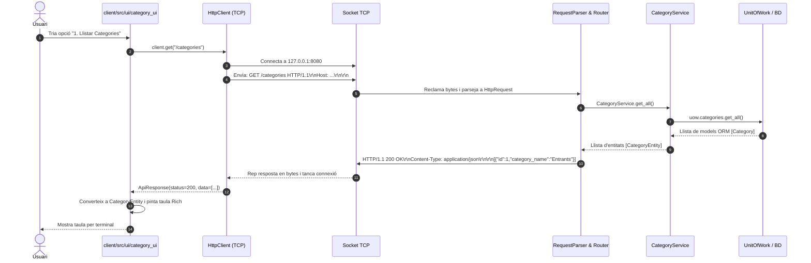

# Documentació d'Estudi, Repàs i Arquitectura — Restaurant BackOffice v2.0

> 🌐 **Idioma:** [English (PROJECT_DOCUMENTATION_ENG.md)](PROJECT_DOCUMENTATION_ENG.md) | **Català (PROJECT_DOCUMENTATION_CAT.md)**  
> **Guia completa per a estudiants de 2n de DAM (Desenvolupament d'Aplicacions Multiplataforma)**  
> Mòduls implicats: M0486 (Accés a Dades), M0487 (Programació de Serveis i Processos) i M0488 (Sistemes de Gestió Empresarial).

---

## Índex de Continguts
1. [Introducció i Context del Projecte](#1-introducció-i-context-del-projecte)
2. [Conceptes Clau per a l'Estudi i Repàs (DAM)](#2-conceptes-clau-per-a-lestudi-i-repàs-dam)
   - [2.1 Sockets TCP i el concepte de "Byte Stream"](#21-sockets-tcp-i-el-concepte-de-byte-stream)
   - [2.2 El problema de la delimitació de missatges (Framing)](#22-el-problema-de-la-delimitació-de-missatges-framing)
   - [2.3 Per què JSON i UTF-8 en lloc de Pickle?](#23-per-què-json-i-utf-8-en-lloc-de-pickle)
   - [2.4 El model "Stateless" (Sense Estat)](#24-el-model-stateless-sense-estat)
   - [2.5 Arquitectura "Clean Domain" (Domini Net)](#25-arquitectura-clean-domain-domini-net)
   - [2.6 La Capa de Serveis (Service Layer) i el Router](#26-la-capa-de-serveis-service-layer-i-el-router)
   - [2.7 Patrons Unit of Work i Repositori](#27-patrons-unit-of-work-i-repositori)
3. [Estructura del Projecte](#3-estructura-del-projecte)
4. [Com funciona l'aplicació pas a pas](#4-com-funciona-laplicació-pas-a-pas)
   - [Exemple 1: Llistar Categories (Lectura simple)](#exemple-1-llistar-categories-lectura-simple)
   - [Exemple 2: Crear Empleat amb Credencials (Relació 1:1 i xifrat SHA-256)](#exemple-2-crear-empleat-amb-credencials-relació-11-i-xifrat-sha-256)
   - [Exemple 3: Afegir un Al·lèrgen a un Plat (Relació N:M)](#exemple-3-afegir-un-allèrgen-a-un-plat-relació-nm)
5. [Guia d'Engegada i Execució](#5-guia-dengegada-i-execució)
6. [Bateria de Preguntes i Respostes per a la Defensa Oral](#6-bateria-de-preguntes-i-respostes-per-a-la-defensa-oral)

---

## 1. Introducció i Context del Projecte

A la versió anterior (v1.0), l'aplicació era un monòlit de consola (CLI): la mateixa pantalla de l'usuari creava connexions directes a la base de dades PostgreSQL mitjançant SQLAlchemy.

### Quins problemes tenia aquesta arquitectura inicial?
1. **Manca de seguretat**: El client requeria credencials directes de la base de dades (usuari, contrasenya, port de PostgreSQL). En un entorn real, qualsevol usuari podria descompilar l'aplicació i manipular la BD.
2. **Acoblament tecnològic**: Si la base de dades canviava (ex: de PostgreSQL a MongoDB), calia actualitzar i redistribuir tots els clients instal·lats.
3. **Impossibilitat d'altres clients**: Era impossible crear una aplicació mòbil (Flutter/Android) o una aplicació web (React/Vue) sense haver de reescriure tot el codi de negoci.

### Objectiu assolit a la v2.0:
Hem transformat l'aplicació en una **Arquitectura Client/Servidor** utilitzant **sockets bloquejants en Python** i un **protocol basat en HTTP/1.1 REST**:
- **Servidor (`server/`)**: És l'únic que té accés a SQLAlchemy i a la base de dades PostgreSQL. Escolta connexions TCP, processa peticions i executa la lògica de negoci.
- **Client (`client/`)**: Programa lleuger amb interfície gràfica a la terminal (`rich`). No té cap dependència de SQLAlchemy ni de la base de dades. Tot ho sol·licita al Servidor a través de TCP.
- **Domini Net (`common/`)**: Entitats pures de Python compartides entre client i servidor que no contenen dependències d'ORM.

---

## 2. Conceptes Clau per a l'Estudi i Repàs (DAM)

### 2.1 Sockets TCP i el concepte de "Byte Stream"
- **Què és un socket?** És un punt final (endpoint) d'una comunicació bidireccional entre dos programes a través de la xarxa. En Python es crea amb `socket.socket(socket.AF_INET, socket.SOCK_STREAM)`:
  - `AF_INET`: Família d'adreces IPv4.
  - `SOCK_STREAM`: Protocol orientat a la connexió fiable (TCP).
- **El flux continu de bytes (Stream)**: A diferència d'UDP (on cada missatge és un paquet independent), TCP garanteix que les dades arriben ordenades i sense pèrdues, però **no sap què és una paraula, una frase o un objecte**. TCP veu un riu continu de bytes (`b"GET /categories HTTP/1.1\r\n..."`).

### 2.2 El problema de la delimitació de missatges (Framing)
Quan un receptor llegeix d'un socket amb `recv(1024)`, com sap on acaba la petició actual?
Hi ha tres solucions conegudes en xarxes:
1. **Afegir un delimitador final fix**: Per exemple, finalitzar amb `\n` o `####`.
2. **Prefixar la mida**: Enviar primer 4 bytes indicant quants bytes mesura el missatge.
3. **Protocol HTTP estàndard (la solució implementada)**:
   - Les línies de text acaben amb `\r\n` (CRLF).
   - Les capçaleres acaben amb **línia buida** (`\r\n\r\n`).
   - Si hi ha un cos de dades (body), la capçalera `Content-Length` indica exactament quants bytes mesura el cos.

### 2.3 Per què JSON i UTF-8 en lloc de Pickle?
A classe es va parlar d'utilitzar `pickle` per enviar objectes directament. **Per què està desaconsellat?**
- **Vulnerabilitat d'injecció de codi**: `pickle.loads()` pot executar codi Python arbitrari amagat dins de les dades. Si un client maliciós envia un objecte modificat, podria prendre el control del servidor.
- **Incompatibilitat**: Pickle només funciona entre programes Python amb la mateixa versió.
- **Avantatge de JSON + UTF-8**: JSON és un estàndard universal obert, segur, llegible i suportat per qualsevol llenguatge (Java, JavaScript, C#, Kotlin, etc.).

### 2.4 El model "Stateless" (Sense Estat)
- El protocol utilitzat és **stateless**: cada connexió és autònoma.
- El client es connecta, envia la seva instrucció, rep la resposta i el socket es tanca immediatament (`Connection: close`).
- **Avantatges**:
  - Si el client es desconnecta o es reinicia, el servidor no es queda amb recursos bloquejats.
  - El servidor no ha de mantenir llistes de sessions en memòria, fent-lo molt més robust i fàcil de testejar.

### 2.5 Arquitectura "Clean Domain" (Domini Net)
- **Problema**: Els models de SQLAlchemy (`models.py`) contenen sessions, relacions mandroses (lazy-loading) i metadades que fallen estrepitosament si s'intenten enviar per un socket o fer-ne `json.dumps()`.
- **Solució ("Clean Domain")**:
  - Hem creat `common/domain/entities.py` amb classes pures (`@dataclass`).
  - No importen SQLAlchemy.
  - Tenen mètodes `to_dict()` i `from_dict()`.
  - El servidor converteix els models de la BD a entitats netes mitjançant mappers (`server/src/persistence/mappers.py`).

### 2.6 La Capa de Serveis (Service Layer) i el Router
- **Router (`router.py`)**: Analitza la URL i el mètode HTTP (`GET /categories`) i sap quin servei ha d'activar.
- **Capa de Serveis (`services/`)**: Conté la **lògica de negoci**. Mai posem lògica de negoci a la interfície d'usuari ni als repositoris.
  - Exemple: Comprovar que un preu no sigui negatiu.
  - Exemple: Generar el hash SHA-256 de la contrasenya abans de persistir les credencials.
  - Exemple: Comprovar que no existeixin categories duplicades.

### 2.7 Patrons Unit of Work i Repositori
- **Repositori (`repositories.py`)**: Encapsula les consultes SQL (`select()`, `where()`, `order_by()`). Simula una col·lecció en memòria.
- **Unit of Work (`unit_of_work.py`)**: Gestiona la transacció de la base de dades. Si totes les operacions dins del bloc `with` acaben bé, fa `commit()`; si es produeix qualsevol excepció, fa `rollback()` automàtic per protegir la integritat de les dades.

---

## 3. Estructura del Projecte

```
restaurant_backoffice/
│
├── common/                          # DOMINI NET COMPARTIT
│   └── domain/
│       ├── __init__.py
│       └── entities.py              # Classes pures (CategoryEntity, DishEntity, etc.)
│
├── server/                          # COSTAT SERVIDOR
│   ├── server.py                    # Bucle principal del socket TCP
│   └── src/
│       ├── persistence/             # PERSISTÈNCIA (NOMÉS SERVIDOR)
│       │   ├── config.py            # Configuració de BD i ports
│       │   ├── db.py                # Engine i Base de SQLAlchemy
│       │   ├── models.py            # Models ORM (Employee, Dish, Sale...)
│       │   ├── repositories.py      # CRUD i consultes SQL
│       │   ├── unit_of_work.py      # Gestor transaccional (UoW)
│       │   └── mappers.py           # Conversió Models ORM <-> Entitats Netes
│       ├── services/                # CAPA DE SERVEIS (LÒGICA DE NEGOCI)
│       │   ├── category_service.py
│       │   ├── allergen_service.py
│       │   ├── dish_service.py
│       │   ├── employee_service.py
│       │   ├── menu_service.py
│       │   └── sale_service.py
│       └── protocol/                # PROTOCOL HTTP SOBRE TCP
│           ├── request_parser.py    # Descodifica bytes TCP a HttpRequest
│           ├── response_builder.py  # Construeix respostes HTTP en bytes
│           └── router.py            # Enrutador de peticions cap als serveis
│
├── client/                          # COSTAT CLIENT
│   ├── client.py                    # Punt d'entrada del client
│   └── src/
│       ├── protocol/
│       │   └── http_client.py       # Client TCP que parla HTTP/1.1
│       └── ui/                      # INTERFÍCIES D'USUARI AMB RICH
│           ├── category_ui.py
│           ├── allergen_ui.py
│           ├── dish_ui.py
│           ├── employee_ui.py
│           ├── menu_ui.py
│           └── sale_ui.py
│
├── tests/                           # BATERIA DE TESTS AUTOMATITZATS
│   ├── test_request_parser.py       # Tests de serialització/deserialització
│   ├── test_response_builder.py     # Tests de construcció de respostes
│   ├── test_services.py             # Tests de lògica de negoci amb Mocks
│   ├── test_router.py               # Tests d'enrutament
│   └── test_client_server_integration.py # Prova real de socket TCP Client-Servidor
│
├── PROTOCOL_ENG.md                  # Especificació tècnica del protocol (Anglès)
├── PROTOCOL_CAT.md                  # Especificació tècnica del protocol (Català)
├── PROJECT_DOCUMENTATION_ENG.md     # Documentació d'estudi i arquitectura (Anglès)
├── PROJECT_DOCUMENTATION_CAT.md     # Documentació d'estudi i arquitectura (Català)
├── EXECUTION_GUIDE_ENG.md           # Guia d'execució i proves (Anglès)
├── EXECUTION_GUIDE_CAT.md           # Guia d'execució i proves (Català)
├── pyproject.toml                   # Configuració de pytest
└── requirements.txt                 # Dependències del projecte
```

---

## 4. Com funciona l'aplicació pas a pas

### Exemple 1: Llistar Categories (Lectura simple)



---

### Exemple 2: Crear Empleat amb Credencials (Relació 1:1 i xifrat SHA-256)

1. L'usuari introdueix les dades personals (Nom, Cognom, DNI, Rol) i accepta crear credencials d'accés (Email, Contrasenya).
2. La UI envia una petició `POST /employees` amb el cos JSON:
   ```json
   {
     "name": "Laura",
     "surname": "Vidal",
     "national_id": "48123456Z",
     "role": "Cuinera",
     "email": "laura@restaurant.com",
     "password": "PasswordSegur123"
   }
   ```
3. El `EmployeeService` al servidor rep les dades i:
   - Comprova que el DNI no estigui duplicat (`national_id_exists`).
   - Aplica **hashing irreversible SHA-256** a la contrasenya:
     ```python
     pwd_hash = hashlib.sha256("PasswordSegur123".encode()).hexdigest()
     ```
   - Crea l'objecte `AppCredential` associat a l'empleat.
   - Obre la transacció `uow` i desa ambdues entitats alhora garantint la relació 1:1.
4. El servidor retorna `201 Created` amb les dades de l'empleat, **però sense retornar mai el hash de la contrasenya** cap al client (bona pràctica de seguretat).

---

### Exemple 3: Afegir un Al·lèrgen a un Plat (Relació N:M)

1. El client envia `POST /dishes/3/allergens` amb `{"id_allergen": 2}`.
2. El Router extreu l'ID del plat (`3`) de la URL i l'ID de l'al·lèrgen (`2`) del cos.
3. El `DishService` recupera el plat i l'al·lèrgen a la base de dades.
4. El repositori afegeix l'al·lèrgen a la col·lecció del plat:
   ```python
   dish.allergens.append(allergen)
   ```
5. SQLAlchemy gestiona la taula d'associació `dish_allergen` i insereix la fila corresponent automàticament.
6. El servidor retorna `200 OK` amb `{"added": true}`.

---

## 5. Guia d'Engegada i Execució

### Pas 1: Configurar l'entorn virtual
```bash
python3 -m venv .venv
source .venv/bin/activate
pip install -r requirements.txt
```

### Pas 2: Iniciar la base de dades PostgreSQL (amb Docker)
```bash
docker-compose up -d
```

### Pas 3: Executar les proves automatitzades
Per verificar que tota la suite de tests (lògica, protocol, router, sockets) funciona al 100%:
```bash
pytest -v
```

### Pas 4: Iniciar el Servidor TCP
En una finestra de terminal:
```bash
python server/server.py
```

### Pas 5: Iniciar el Client
En una altra finestra de terminal:
```bash
python client/client.py
```

---

## 6. Bateria de Preguntes i Respostes per a la Defensa Oral

#### P1: Per què no es pot transmetre un model SQLAlchemy directament per un socket TCP?
> **R:** Un model SQLAlchemy és un objecte complex en memòria lligat a una sessió de base de dades activa, amb referències circulars, proxies d'atributs i càrrega mandrosa (lazy loading). Un socket TCP només pot transportar una seqüència plana de bytes (`bytes`). Per això cal traduir el model a una entitat neta de domini, convertir-la a diccionari, serialitzar-la a JSON i finalment codificar-la a bytes UTF-8.

#### P2: Com sap el servidor o el client quan s'ha acabat d'enviar un missatge HTTP?
> **R:** Les capçaleres sempre acaben amb la combinació de dues salts de línia CRLF (`\r\n\r\n`). Si la petició té un cos (per exemple en un POST o PUT), la capçalera `Content-Length` indica exactament el nombre de bytes que té el cos. El receptor continua llegint del socket fins que ha rebut exactament aquesta quantitat de bytes.

#### P3: Què significa que el protocol sigui "Stateless"?
> **R:** Significa que el servidor no manté cap memòria o estat sobre converses anteriors entre peticions. Cada petició s'obre en una connexió TCP independent, es processa, es respon i es tanca. Això fa que l'aplicació sigui molt més robusta davant de talls de xarxa.

#### P4: Per què les contrasenyes no es guarden mai en text pla ni viatgen al client?
> **R:** Per motius estrictes de seguretat (RGPD i bones pràctiques). Abans de desar la contrasenya a la taula `app_credential`, s'aplica una funció hash criptogràfica (SHA-256). A més, quan el client consulta les dades d'un empleat, el servidor només envia `has_credentials: true` i l'email, mai el hash.

#### P5: Quina diferència hi ha entre el patró Repositori i el patró Unit of Work?
> **R:** El Repositori s'encarrega d'aïllar les consultes a la base de dades (com si fos una col·lecció en memòria: `get`, `add`, `delete`), mentre que el Unit of Work s'encarrega de controlar la transacció empresarial completa (assegurar que totes les operacions d'una mateixa feina es consoliden juntes amb `commit()` o es desfan amb `rollback()`).
