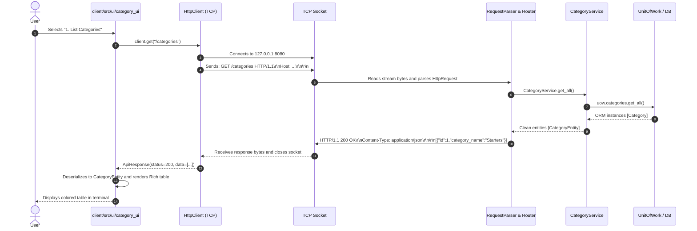

# Architecture, Design & Study Documentation — Restaurant BackOffice v2.0

> 🌐 **Language:** **English (PROJECT_DOCUMENTATION_ENG.md)** | [Català (PROJECT_DOCUMENTATION_CAT.md)](PROJECT_DOCUMENTATION_CAT.md)  
> **Comprehensive Guide for Vocational Software Development Students (DAM - 2nd Year)**  
> Associated Course Modules: M0486 (Data Access), M0487 (Network Services and Processes) & M0488 (Enterprise Management Systems).

---

## Table of Contents
1. [Introduction and Project Context](#1-introduction-and-project-context)
2. [Key Theoretical Concepts & Revision Guide (DAM)](#2-key-theoretical-concepts--revision-guide-dam)
   - [2.1 TCP Sockets and the "Byte Stream" Paradigm](#21-tcp-sockets-and-the-byte-stream-paradigm)
   - [2.2 Stream Framing and Message Delimitation](#22-stream-framing-and-message-delimitation)
   - [2.3 Why JSON and UTF-8 instead of Python's Pickle?](#23-why-json-and-utf-8-instead-of-pythons-pickle)
   - [2.4 The Stateless Connection Model](#24-the-stateless-connection-model)
   - [2.5 Clean Domain Architecture](#25-clean-domain-architecture)
   - [2.6 Service Layer and Router Pattern](#26-service-layer-and-router-pattern)
   - [2.7 Unit of Work and Repository Patterns](#27-unit-of-work-and-repository-patterns)
3. [Project Directory Layout](#3-project-directory-layout)
4. [Step-by-Step Application Workflow](#4-step-by-step-application-workflow)
   - [Case 1: List Categories (Simple Read Operation)](#case-1-list-categories-simple-read-operation)
   - [Case 2: Create Employee with Credentials (1:1 & SHA-256 Hashing)](#case-2-create-employee-with-credentials-11--sha-256-hashing)
   - [Case 3: Associate Allergen to Dish (N:M Relationship)](#case-3-associate-allergen-to-dish-nm-relationship)
5. [Startup and Execution Guide](#5-startup-and-execution-guide)
6. [Exam Questions & Oral Defense Preparation Guide](#6-exam-questions--oral-defense-preparation-guide)

---

## 1. Introduction and Project Context

In the previous iteration (v1.0), the application was a monolithic command-line interface (CLI): the terminal user interface established direct connections to the PostgreSQL database through SQLAlchemy.

### Shortcomings of the Initial Monolith:
1. **Security Vulnerability:** The client required direct database credentials (database username, password, host, and port). In real-world environments, decompiling or intercepting the client exposes the central database directly to malicious attacks.
2. **Technological Coupling:** Any database schema migration or database vendor change required redeploying all client installations.
3. **Inability to Support Modern Clients:** Building mobile applications (Flutter/Android) or web frontends (React/Vue) was unfeasible without rewriting the core business logic from scratch.

### Architectural Milestone Achieved in v2.0:
We refactored the codebase into a decoupled **Client/Server Architecture** using **blocking TCP sockets in Python** and a **REST-inspired application protocol over HTTP/1.1**:
- **Server (`server/`):** The exclusive custodian of database access (PostgreSQL via SQLAlchemy). It listens on a TCP socket, validates requests, and executes business operations.
- **Client (`client/`):** A standalone terminal application styled with `rich`. It contains zero database or SQLAlchemy dependencies, requesting all data through TCP sockets.
- **Clean Domain (`common/`):** Pure Python data models shared across client and server with no ORM dependencies.

---

## 2. Key Theoretical Concepts & Revision Guide (DAM)

### 2.1 TCP Sockets and the "Byte Stream" Paradigm
- **What is a Socket?** An endpoint of a bi-directional network communication channel between two processes. In Python, created via `socket.socket(socket.AF_INET, socket.SOCK_STREAM)`:
  - `AF_INET`: IPv4 network address family.
  - `SOCK_STREAM`: Reliable, connection-oriented byte stream (TCP).
- **The Byte Stream Phenomenon:** Unlike UDP (which preserves discrete packet boundaries), TCP delivers bytes reliably in sequence, but **has no awareness of messages, sentences, or objects**. TCP delivers an unstructured stream of bytes (`b"GET /categories HTTP/1.1\r\n..."`).

### 2.2 Stream Framing and Message Delimitation
When reading bytes from a socket with `recv(1024)`, how does a receiver identify where a message ends?
Three standard networking strategies exist:
1. **Delimiter Tokens:** Appending a delimiter string such as `\n` or `####`.
2. **Prefix Length Header:** Sending a fixed 4-byte integer upfront denoting the exact message payload length.
3. **HTTP Standard Protocol (Our Implemented Solution):**
   - Header lines terminate with standard CRLF (`\r\n`).
   - The end of the headers is uniquely delimited by an **empty line** (`\r\n\r\n`).
   - If a payload body exists, the `Content-Length` header states the exact byte size to consume from the socket.

### 2.3 Why JSON and UTF-8 instead of Python's Pickle?
- **Remote Code Execution Vulnerability:** `pickle.loads()` can deserialize arbitrary Python bytecode. An untrusted or compromised client can craft a malicious pickle payload to take over the server.
- **Portability:** Pickle only functions between identical Python versions and cannot interface with web browsers, Java, or C# clients.
- **JSON + UTF-8 Superiority:** JSON is a language-agnostic, secure, human-readable standard natively supported by all platforms and modern web browsers.

### 2.4 The Stateless Connection Model
- The protocol is **stateless**: every interaction is self-contained.
- The client connects, sends its request, reads the complete response, and the TCP socket is closed (`Connection: close`).
- **Benefits:**
  - If a client disconnects unexpectedly, the server leaks no open socket resources.
  - The server maintains no session state in RAM, simplifying testing and scalability.

### 2.5 Clean Domain Architecture
- **Problem:** SQLAlchemy ORM instances (`models.py`) encapsulate active database sessions, lazy-loading triggers, and circular relational graphs that fail if directly transmitted over a socket or passed to `json.dumps()`.
- **Solution (Clean Domain):**
  - We declared clean dataclasses in `common/domain/entities.py`.
  - They have zero imports from `sqlalchemy`.
  - They provide explicit `to_dict()` and `from_dict()` serialization helpers.
  - The server maps ORM objects into pure domain entities via `server/src/persistence/mappers.py`.

### 2.6 Service Layer and Router Pattern
- **Router (`router.py`):** Inspects the HTTP verb (`GET`, `POST`, `PUT`, `DELETE`) and path segments, routing incoming requests to the designated service method.
- **Service Layer (`services/`):** Contains all **business logic**. Business rules must never leak into presentation UIs or database repositories.
  - Validates inputs (e.g., verifying menu prices are positive).
  - Encrypts credentials with SHA-256 hashing.
  - Guarantees uniqueness before persisting.

### 2.7 Unit of Work and Repository Patterns
- **Repository Pattern (`repositories.py`):** Isolates SQL queries (`select()`, `where()`, `order_by()`), providing an in-memory collection abstraction (`get`, `add`, `delete`).
- **Unit of Work Pattern (`unit_of_work.py`):** Coordinates business transactions. If all operations within a `with` block succeed, it triggers `commit()`; upon any unhandled exception, it automatically invokes `rollback()`.

---

## 3. Project Directory Layout

```
restaurant_backoffice/
│
├── common/                          # SHARED CLEAN DOMAIN
│   └── domain/
│       ├── __init__.py
│       └── entities.py              # Pure dataclasses (CategoryEntity, DishEntity, etc.)
│
├── server/                          # SERVER SUBSYSTEM
│   ├── server.py                    # Main blocking TCP socket listener loop
│   └── src/
│       ├── persistence/             # PERSISTENCE LAYER (SERVER ONLY)
│       │   ├── config.py            # Database and network configuration
│       │   ├── db.py                # SQLAlchemy Engine and Base
│       │   ├── models.py            # ORM Models (Employee, Dish, Sale...)
│       │   ├── repositories.py      # SQL query abstraction
│       │   ├── unit_of_work.py      # Transaction manager (UoW)
│       │   └── mappers.py           # ORM Model <-> Clean Entity mappers
│       ├── services/                # SERVICE LAYER (BUSINESS LOGIC)
│       │   ├── category_service.py
│       │   ├── allergen_service.py
│       │   ├── dish_service.py
│       │   ├── employee_service.py
│       │   ├── menu_service.py
│       │   └── sale_service.py
│       └── protocol/                # PROTOCOL OVER TCP
│           ├── request_parser.py    # Decodes raw TCP stream into HttpRequest
│           ├── response_builder.py  # Builds valid HTTP byte responses
│           └── router.py            # Dispatches requests to service layer
│
├── client/                          # CLIENT SUBSYSTEM
│   ├── client.py                    # Terminal client entry point
│   └── src/
│       ├── protocol/
│       │   └── http_client.py       # Custom TCP socket HTTP client
│       └── ui/                      # PRESENTATION LAYER (RICH CLI)
│           ├── category_ui.py
│           ├── allergen_ui.py
│           ├── dish_ui.py
│           ├── employee_ui.py
│           ├── menu_ui.py
│           └── sale_ui.py
│
├── tests/                           # AUTOMATED TEST SUITE
│   ├── test_request_parser.py       # Serialization/deserialization tests
│   ├── test_response_builder.py     # HTTP response builder tests
│   ├── test_services.py             # Service logic tests with Mocks
│   ├── test_router.py               # Request router tests
│   └── test_client_server_integration.py # Real TCP client/server integration test
│
├── PROTOCOL_ENG.md                  # Protocol Specification (English)
├── PROTOCOL_CAT.md                  # Protocol Specification (Catalan)
├── PROJECT_DOCUMENTATION_ENG.md     # Architecture & Study Guide (English)
├── PROJECT_DOCUMENTATION_CAT.md     # Architecture & Study Guide (Catalan)
├── EXECUTION_GUIDE_ENG.md           # Execution Guide (English)
├── EXECUTION_GUIDE_CAT.md           # Execution Guide (Catalan)
├── pyproject.toml                   # Pytest configuration
└── requirements.txt                 # Project dependencies
```

---

## 4. Step-by-Step Application Workflow

### Case 1: List Categories (Simple Read Operation)



---

### Case 2: Create Employee with Credentials (1:1 & SHA-256 Hashing)

1. The terminal user inputs personal details (Name, Surname, National ID, Role) and chooses to configure credentials (Email, Password).
2. The UI sends a `POST /employees` request carrying the JSON body:
   ```json
   {
     "name": "Laura",
     "surname": "Vidal",
     "national_id": "48123456Z",
     "role": "Chef",
     "email": "laura@restaurant.com",
     "password": "PasswordSegur123"
   }
   ```
3. `EmployeeService` on the server receives the request and:
   - Validates that the National ID is unique (`national_id_exists`).
   - Generates an **irreversible SHA-256 cryptographic hash** of the password:
     ```python
     pwd_hash = hashlib.sha256("PasswordSegur123".encode()).hexdigest()
     ```
   - Instantiates `AppCredential` associated with the new `Employee`.
   - Opens the Unit of Work transaction and persists both records atomically.
4. The server returns `201 Created` with employee details, **never leaking password hashes to the client**.

---

### Case 3: Associate Allergen to Dish (N:M Relationship)

1. The client sends `POST /dishes/3/allergens` with body `{"id_allergen": 2}`.
2. The Router extracts the dish ID (`3`) from the path and the allergen ID (`2`) from the payload.
3. `DishService` retrieves both entities from the database.
4. The repository appends the allergen to the dish:
   ```python
   dish.allergens.append(allergen)
   ```
5. SQLAlchemy automatically generates and executes the insert statement for the join table `dish_allergen`.
6. The server returns `200 OK` with `{"added": true}`.

---

## 5. Startup and Execution Guide

### Step 1: Virtual Environment Activation
```bash
python3 -m venv .venv
source .venv/bin/activate
pip install -r requirements.txt
```

### Step 2: Start PostgreSQL Database Container
```bash
docker-compose up -d
```

### Step 3: Run Automated Test Suite
```bash
pytest -v
```

### Step 4: Start TCP Server
In terminal 1:
```bash
python server/server.py
```

### Step 5: Start Interactive Client
In terminal 2:
```bash
python client/client.py
```

---

## 6. Exam Questions & Oral Defense Preparation Guide

#### Q1: Why can't a SQLAlchemy ORM model be sent directly across a TCP socket?
> **Answer:** A SQLAlchemy ORM model is a complex in-memory Python object tied to a live database session with lazy-loading proxies and circular references. A TCP socket can only transmit raw sequences of bytes. The ORM model must be mapped to a clean domain entity, converted to a dictionary, serialized into JSON text, and encoded into UTF-8 bytes.

#### Q2: How does the server or client determine when an HTTP message has completed?
> **Answer:** Headers are delimited by an empty CRLF line (`\r\n\r\n`). If a payload exists (e.g. POST or PUT), the `Content-Length` header indicates the exact byte size of the body. The receiver continues reading until exactly that number of body bytes has been gathered.

#### Q3: What is the significance of the "Stateless" connection model?
> **Answer:** The server retains no memory of previous requests from the client. Each interaction establishes a fresh TCP socket, executes, returns a response, and terminates. This avoids stale connections and resource leaks.

#### Q4: Why are passwords never stored in plain text or transmitted back to the client?
> **Answer:** For security best practices and compliance (GDPR). Passwords are hashed with SHA-256 before insertion into `app_credential`. When client requests employee details, the server only indicates `has_credentials: true` and the email address.

#### Q5: What is the architectural difference between the Repository and Unit of Work patterns?
> **Answer:** The Repository isolates database query logic, presenting an in-memory collection interface (`get`, `add`, `delete`). The Unit of Work manages atomic business transactions, ensuring all changes in a workflow succeed together with `commit()` or revert completely upon error via `rollback()`.
