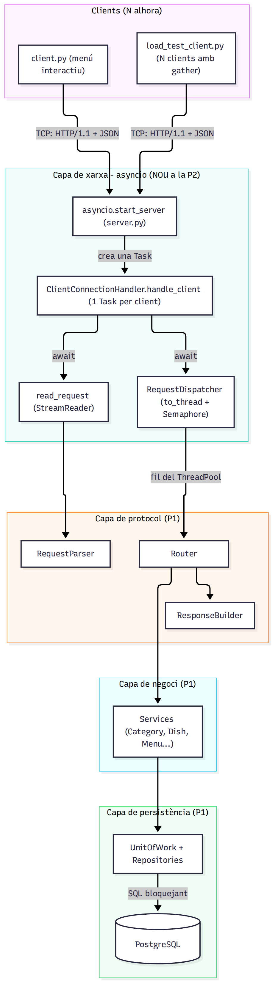
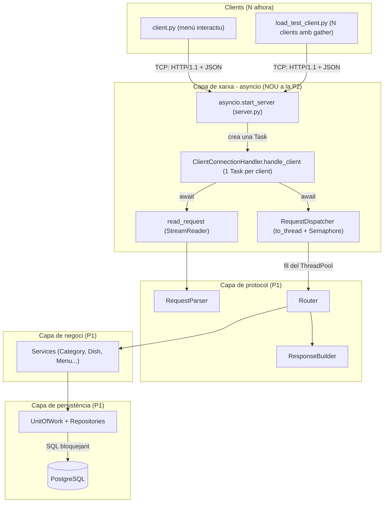
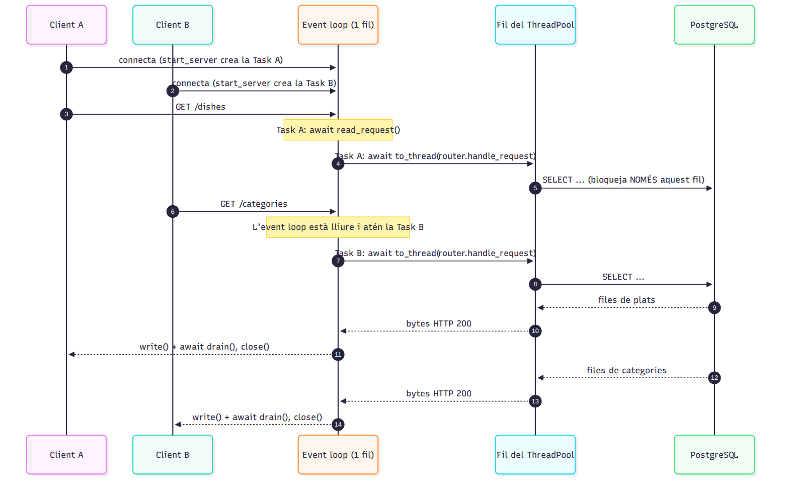
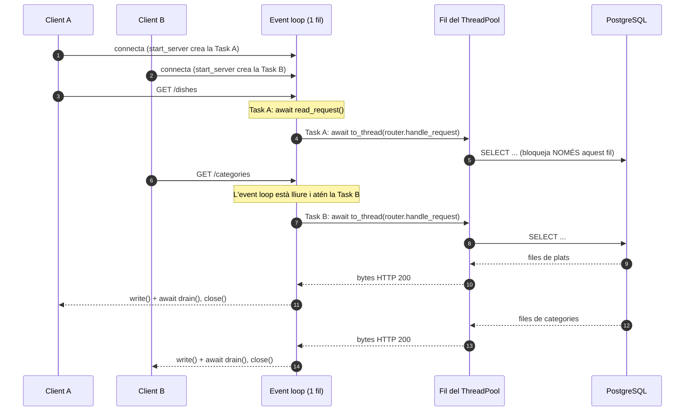
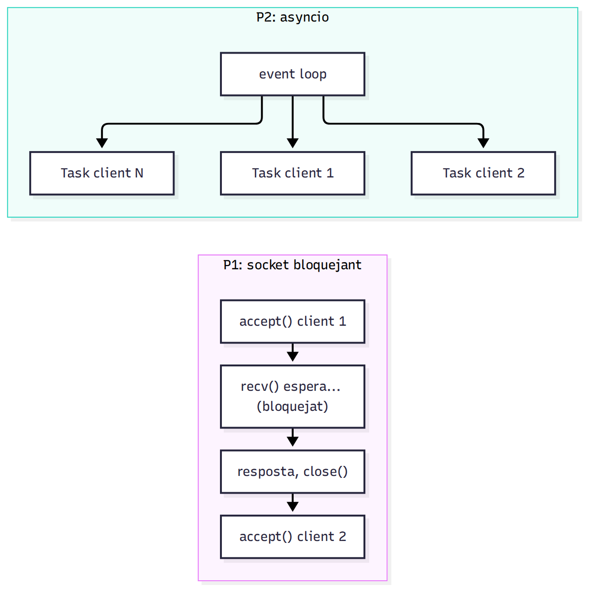
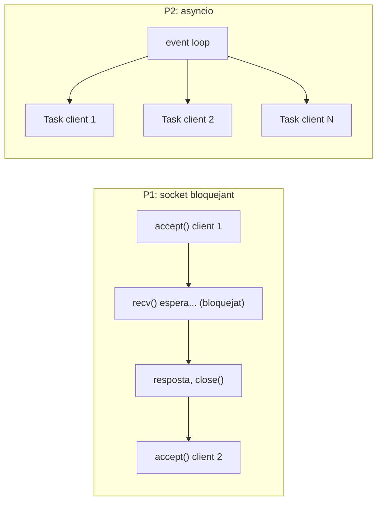

# Arquitectura del servidor asíncron (asyncio): Restaurant BackOffice v3.0

## 1. Resum

- **Pràctica 1:** servidor TCP amb sockets bloquejants. Atenia **un client alhora**: mentre esperava un `recv()`, la resta de clients feien cua.
- **Pràctica 2:** servidor amb `asyncio.start_server`. Cada client té **la seva Task** i totes comparteixen **un sol fil** (l'event loop). Quan una Task fa `await`, cedeix el torn a les altres.
- La base de dades (SQLAlchemy + psycopg2) és **bloquejant**, així que s'executa **en fils** (`asyncio.to_thread`) limitats per un `asyncio.Semaphore`. Així l'event loop no es queda mai aturat.
- Les capes de protocol, negoci i persistència de la P1 es reutilitzen **sense canvis**.

## 2. Diagrama de capes

## 3. Diagrama de seqüència: 2 clients concurrents

## 4. Abans vs després

## 5. Fitxer → responsabilitat

| Fitxer | Responsabilitat |
|---|---|
| `server/server.py` | Munta les peces i arrenca `asyncio.start_server` (`async with server` + `serve_forever`) |
| `server/src/network/connection_handler.py` | La vida d'UNA connexió: llegir → processar → respondre → tancar |
| `server/src/network/request_dispatcher.py` | Treu la BD (bloquejant) de l'event loop amb `to_thread` + `Semaphore` |
| `server/src/protocol/async_request_reader.py` | `read_request()`: llegeix una petició HTTP del `StreamReader` (capçaleres + `Content-Length`) |
| `server/src/protocol/request_parser.py` | `RequestParser`: funcions pures, bytes → `HttpRequest` |
| `server/src/protocol/router.py` | `Router`: decideix quin servei crida segons mètode i ruta (codi de la P1) |
| `server/src/protocol/response_builder.py` | `ResponseBuilder`: construeix els bytes de la resposta HTTP (200, 404, 408, 413, 503...) |
| `server/src/services/` | Lògica de negoci i validacions (codi de la P1, sense canvis) |
| `server/src/persistence/` | Models ORM, repositoris, Unit of Work i l'únic *engine* de SQLAlchemy |
| `server/src/bootstrap.py` | Connecta les capes: persistència → serveis → router |

## 6. Cicle de vida d'una connexió

Protocol *stateless*: **1 connexió = 1 petició**.

1. El client connecta i `asyncio.start_server` crea una **Task nova** que executa `handle_client(reader, writer)`.
2. Si ja hi ha massa connexions actives, es respon **503** directament.
3. `read_request()` llegeix la petició dins `asyncio.timeout(READ_TIMEOUT_SECONDS)`.
4. `dispatcher.dispatch(request)` espera un lloc al semàfor i executa el Router amb `asyncio.to_thread`.
5. `writer.write(response)` + `await writer.drain()` (*backpressure*).
6. `finally`: `writer.close()` + `await writer.wait_closed()`. El socket es tanca **sempre**, fins i tot si hi ha hagut errors.

Un error inesperat només fa fallar la Task d'aquell client: el servidor continua atenent els altres.

| Límit (`.env`) | Valor per defecte | Què passa si se supera |
|---|---|---|
| `READ_TIMEOUT_SECONDS` | 5 s | **408** Request Timeout |
| `MAX_BODY_SIZE` | 1 MB | **413** Payload Too Large |
| `MAX_CONNECTIONS` | 50 | **503** Service Unavailable |
| `DB_MAX_CONCURRENCY` | 5 (= `pool_size` de SQLAlchemy) | La petició espera torn al `Semaphore` (sense bloquejar el loop) |

## 7. Graceful shutdown

1. Ctrl+C fa que `asyncio.run` cancel·li la Task `main()`.
2. `serve_forever()` rep la cancel·lació.
3. En sortir de l'`async with server`, s'executen `server.close()` i `wait_closed()`: es deixen d'acceptar clients i es tanca el socket d'escolta.
4. Al `finally` de `main()`, `engine.dispose()` tanca les connexions de la BD.
5. `asyncio.run` rellança `KeyboardInterrupt`, que s'ignora al `__main__`. El servidor acaba amb `Server stopped, resources released` i sense *traceback*.

`CancelledError` **no** es captura enlloc: és `BaseException`, no entra a `except Exception`, i per això la cancel·lació funciona sola.
