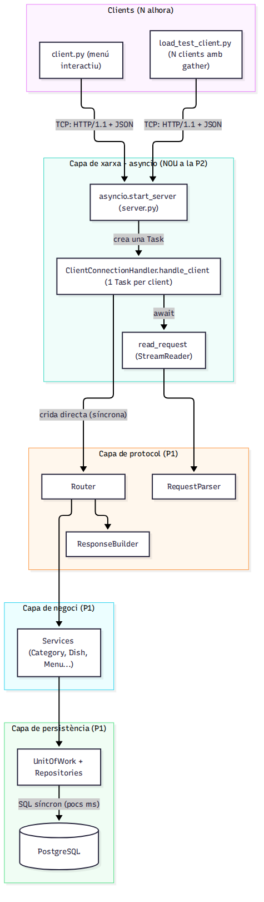
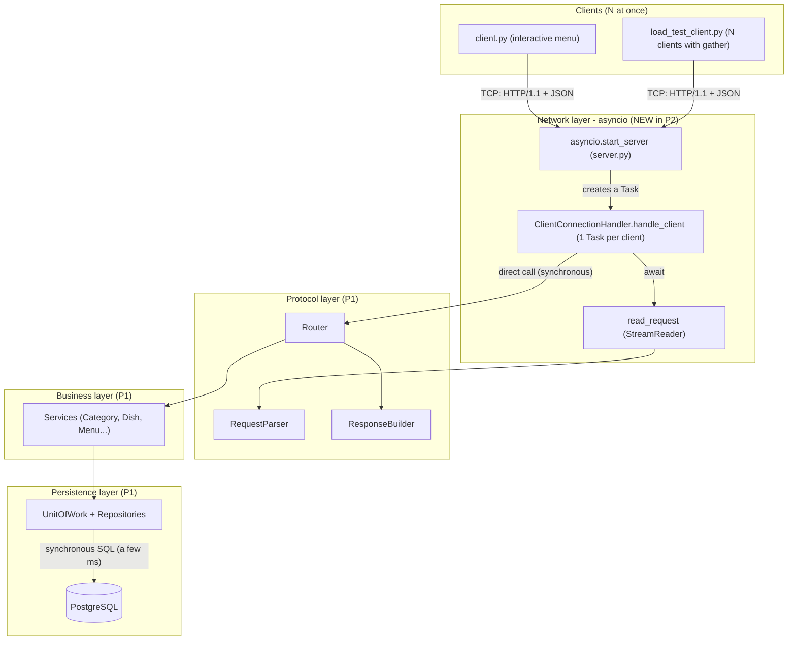
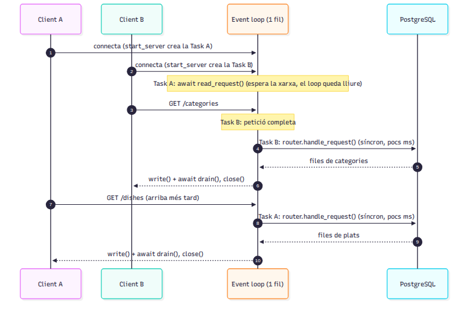
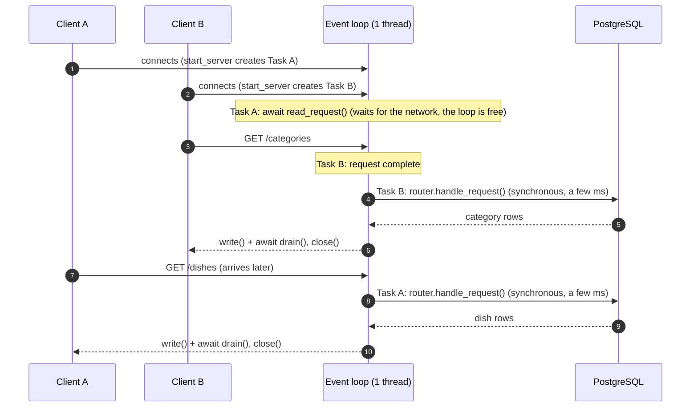
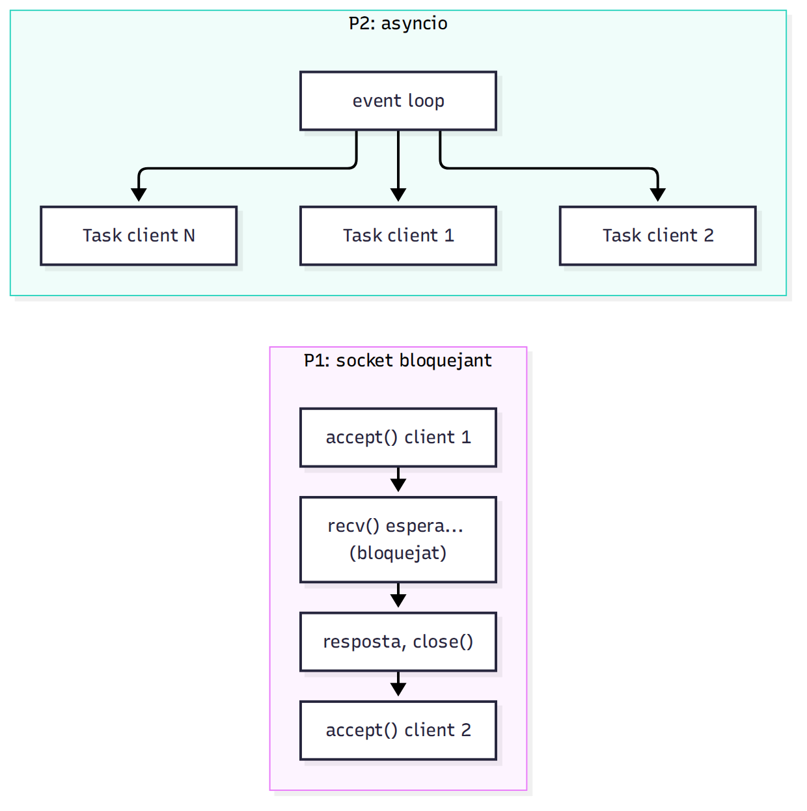
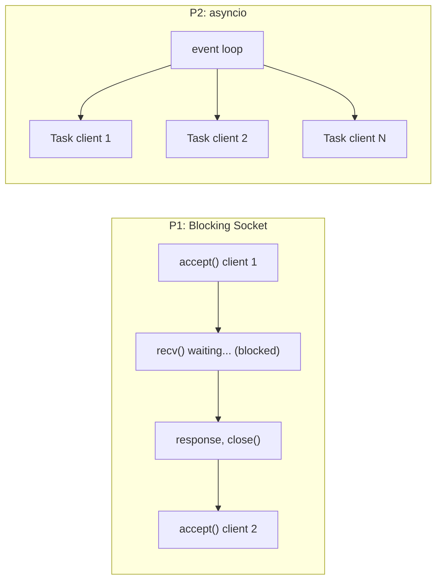

# Asynchronous Server Architecture (asyncio): Restaurant BackOffice v3.0

> **Language:** [English](ARCHITECTURE_ENG.md) | [Català](ARCHITECTURE_CAT.md)

## 1. Summary

- **Practice 1:** TCP server with blocking sockets. Handled **one client at a time**: while waiting for `recv()`, other clients queued up.
- **Practice 2:** Server with `asyncio.start_server`. Each client has **its own Task** and all share **a single thread** (the event loop). When a Task executes `await`, it yields control to the others.
- The database (SQLAlchemy + psycopg2) is **synchronous** and the Router is called **directly** from the event loop: queries take a few milliseconds. The impact is analysed in [DB_ACCESS_ANALYSIS_ENG.md](DB_ACCESS_ANALYSIS_ENG.md).
- The protocol, business logic, and persistence layers from Practice 1 are reused **without changes**.

## 2. Layer Diagram

## 3. Sequence Diagram: 2 Concurrent Clients

## 4. Before vs After

## 5. File → Responsibility

| File | Responsibility |
|---|---|
| `server/server.py` | Assembles components and starts `asyncio.start_server` (`async with server` + `serve_forever`) |
| `server/src/network/connection_handler.py` | Lifecycle of ONE connection: read → process → reply → close |
| `server/src/protocol/async_request_reader.py` | `read_request()`: reads an HTTP request from `StreamReader` (headers + `Content-Length`) |
| `server/src/protocol/request_parser.py` | `RequestParser`: pure parsing functions, bytes → `HttpRequest` |
| `server/src/protocol/router.py` | `Router`: routes requests to matching services by method and path (P1 code) |
| `server/src/protocol/response_builder.py` | `ResponseBuilder`: constructs HTTP response bytes (200, 400, 404, 408, 413...) |
| `server/src/services/` | Business logic and validations (P1 code, unmodified) |
| `server/src/persistence/` | ORM models, repositories, Unit of Work, and the single SQLAlchemy engine |
| `server/src/bootstrap.py` | Layer wiring: persistence → services → router |

## 6. Connection Lifecycle

Stateless protocol: **1 connection = 1 request**.

1. The client connects and `asyncio.start_server` spawns a **new Task** running `handle_client(reader, writer)`.
2. `read_request()` reads the request bounded by `asyncio.timeout(READ_TIMEOUT_SECONDS)`.
3. `router.handle_request(request)` is called directly (synchronous): Router → Services → DB, a few milliseconds.
4. `writer.write(response)` + `await writer.drain()` (*backpressure*).
5. `finally`: `writer.close()` + `await writer.wait_closed()`. The socket is **always closed**, even upon errors.

An unhandled error only crashes that specific client Task; the server keeps running and serving other clients.

| Limit (`.env`) | Default Value | Consequence when Exceeded |
|---|---|---|
| `READ_TIMEOUT_SECONDS` | 5 s | **408** Request Timeout |
| `MAX_BODY_SIZE` | 1 MB | **413** Payload Too Large |

## 7. Graceful Shutdown

1. Ctrl+C causes `asyncio.run` to cancel the `main()` Task.
2. `serve_forever()` receives cancellation.
3. Exiting `async with server` triggers `server.close()` and `wait_closed()`: stops accepting new clients and closes the listening socket.
4. In `main()`'s `finally` block, `engine.dispose()` tears down DB connections.
5. `asyncio.run` re-raises `KeyboardInterrupt`, cleanly handled in `__main__`. The server exits printing `Server stopped, resources released` without tracebacks.

`CancelledError` is **not** swallowed: inheriting from `BaseException`, it bypasses `except Exception`, allowing clean cancellation semantics.
